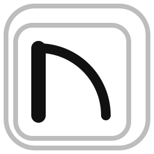

<p align="center"></p>

# pdf2dwfx

**pdf2dwfx** converts vector PDF drawings (exported from CAD software) into **DWFx** files.

> ⚠️ **First version (0.1).** It works, but is still being improved. Always check the result in Autodesk Design Review.

## Why this exists

Portuguese municipalities check submitted architecture projects in DWF viewers. This program was written so those drawings can be made into DWFx files from a PDF; it works for any vector PDF.

## Download and first start

Download the latest version from the [Releases](https://github.com/lourencovp/pdf2dwfx/releases/latest) page:

- **Windows:** `pdf2dwfx-windows.exe`. Nothing to install: double-click it. The first time, Windows may show "Windows protected your PC"; click **More info → Run anyway**.
- **macOS** (Apple-silicon Macs, M1 or newer): `pdf2dwfx-macos.dmg`. Open it and drag pdf2dwfx to Applications. The first time, right-click the app, choose **Open** and confirm (or allow it in System Settings → Privacy & Security).
- **Linux:** `pdf2dwfx-linux.AppImage`. Make it executable (`chmod +x pdf2dwfx-linux.AppImage`) and double-click it.

These warnings appear because the app is not digitally signed yet (planned for a later version). To check that a file is the original, compare its SHA-256 fingerprint with `SHA256SUMS.txt` on the same page.

**How to use:** open the PDF, check each page's scale (yellow = suggested, purple = no scale, green = checked by you; ⚠️ = several scales on the page), double-click a page to set viewports with their own scale, and click **Convert to DWFx**.

## Goals

- Each PDF page becomes one DWFx sheet with exactly the same paper size.
- PDF layers become DWFx layers that can be switched on/off in Autodesk Design Review.
- Scale in metres, so the Design Review measure tool reports correct real-world distances.
- Hatches, fills and text preserved, with coordinates as precise as in the PDF.

## Privacy

The app works **fully offline**: it never connects to the internet and sends no telemetry or automatic reports. Your drawings never leave your computer. If the app fails, it saves a report on your computer (no drawing content or file names) and you decide whether to share it on GitHub.

## For developers

Requires [uv](https://docs.astral.sh/uv/).

```sh
uv sync          # install dependencies
uv run pytest    # run the tests
uv run pdf2dwfx-app [drawing.pdf]   # the app window: check scales, convert
uv run python packaging/build.py    # build the installable app for this system (dist/release/)

uv run pdf2dwfx drawing.pdf              # writes drawing.dwfx next to the PDF
uv run pdf2dwfx drawing.pdf --pages 1-3,7 -o sheets.dwfx
```

**Scales.** Each sheet measures in metres in Design Review. The scale of
each page is found automatically (from PDF measurement data, or from scale
texts such as "SCALE: 1:100" and drawing titles such as "SECTION AA' 1:5",
which get their own viewport). Check and correct them:

```sh
uv run pdf2dwfx drawing.pdf --show-scales                  # list what was found, do not convert
uv run pdf2dwfx drawing.pdf --scale "1-4=1:200,9=paper"    # whole-sheet scales
uv run pdf2dwfx drawing.pdf --viewport "17:20,150,145,285=1:5"  # area in mm from the top-left corner
uv run pdf2dwfx drawing.pdf --no-suggest                   # no guessing: paper millimetres
```

## License

[GNU AGPL-3.0](LICENSE).

The app uses the [Inter](https://rsms.me/inter/) font, under the [SIL Open Font License 1.1](src/pdf2dwfx/assets/fonts/Inter-LICENSE.txt).
